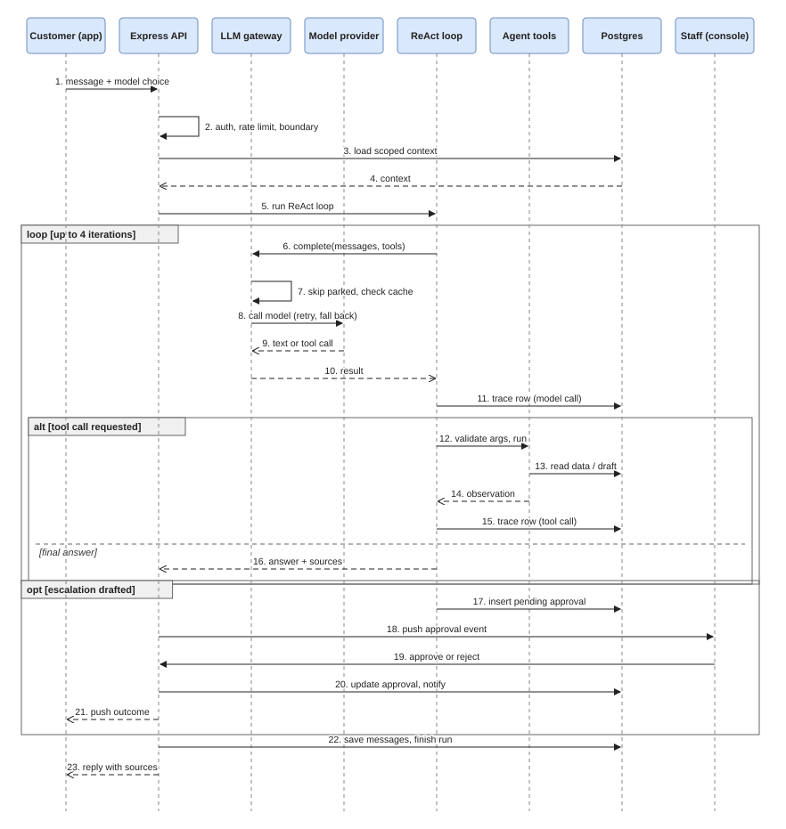

# RESOLV-HQ — Final Engineering Report

**Project:** RESOLV-HQ support-request triage agent | **Group lead:** Hillary | **Week ending:** 23 Oct 2026 | **Template:** capstone brief §9 | **Last revised:** 23 Oct 2026

> **Status of this draft.** Figures come from the project's weekly documents and evidence files, which are summarised in the sections below. Work done after the Week 7 evaluation (documents and attachments, model selection, gateway reliability, dashboard, in-app documentation) is described as **built and type-checked, not live-tested** unless a test or trace is named. Items marked **[LEAD TO CONFIRM]** need a fact only the team can supply (a live re-run, a deploy, a link). Nothing here claims a live result that is not recorded in the evidence.

---

## 1. Executive summary

**Problem.** Support teams answer the same questions repeatedly, and customers wait for a reply to learn the status of a request they already filed. Most of the work is lookup and routing. A small part needs a human decision (refunds, billing, account changes).

**User.** Two groups: customers (mobile and web app) asking about their own requests and the help articles, and support staff (web console) who review what the AI proposes.

**Solution.** A bounded agent with read-only and draft-only tools. It answers from an approved knowledge base with citations, looks up the caller's own account and request status, and drafts an escalation. It cannot refund, change billing or account details, cancel a service or delete anything. Any proposed action waits in an approval queue until staff approve it. The system was built in this order: model → RAG → tools → bounded ReAct loop (max 4 iterations) → memory → evaluation and tracing → guardrails.

**Major result.** The full path works end to end on a live model, with every step persisted to a trace table and viewable in the console. Around that core the system has a staff console, a customer mobile and web app, document upload and in-app preview (PDF, Word, images), user-selectable models with automatic fallback, a reliability dashboard, a scheduler and in-app documentation. 41 backend tests pass and all three repos type-check clean (23 Oct); the 17 console tests were last run on 21 Oct. Eleven failures were catalogued (F1 to F11); ten have a fix or mitigation.

**Principal limitation.** The evaluation is thin on live evidence: of 34 defined scenarios, only 9 have a recorded result (5 pass on code-path evidence, 3 partial, 1 fail) and 25 are not run **[LEAD TO CONFIRM whether the Week 8 live runs happened; update §8 if so]**. Failure F4 (a restaurant menu in the corpus answered support queries with cited prices) was open at the last recorded re-test.

---

## 2. Problem context and requirements

| Item | Summary |
|---|---|
| Workflow | Customer asks or reports → agent retrieves grounded passages and/or looks up the caller's data → answers with sources, or drafts an escalation → staff approve or reject → customer is told the outcome. |
| Single use case | Early docs described a procurement assistant while the code built support triage. On 25 Sept the team settled on support triage and aligned the README, prompts and data. |
| Requirements | Charter and 8–12 user stories are tracked as retroactive Week 1 items **[LEAD TO CONFIRM that they now exist; add as Appendix A]**. |
| AI Boundary Matrix | Ten capability rules, each marked AI-allowed or human-approval-required. Enforced twice: a prompt rule against claiming actions, and a code check on the model's reply (§8). |
| Success measures | Task completion, groundedness, tool selection, instruction following, latency (≤ 15 s per run), safety violations (target 0). |

## 3. System architecture

| Component | Stack | Responsibility |
|---|---|---|
| `resolv-hq` | Vite, React 19, Tailwind 4, shadcn/base-ui | Staff and admin console: chat, approvals queue, agent activity drawer, traces and logs, dashboard (agent runs, hallucination proxy, temperature), knowledge base, AI models, memory, scheduler, MCP, in-app Documentation page |
| `resolv-hq-backend` | Express, Prisma, Supabase, Redis, RabbitMQ | API; per-caller context loaders; LLM gateway with retry, provider fallback, health parking and Redis cache; ReAct loop; five read-only or draft-only tools; guardrails; trace logging; document ingestion; WebSocket and RabbitMQ event delivery; MCP server |
| `resolv-hq-customer` | Expo SDK 57, React Native, NativeWind (web build included) | Customer app: AI chat with model selection, requests with attachments, notifications, memory preferences, in-app document viewing |

| Role | Can do | Cannot do |
|---|---|---|
| Customer | See own requests, notifications and memory; chat with the agent; pick an active model; attach a file for the agent to summarise | Upload to the knowledge base; see other customers' data |
| Staff / admin | Review approvals; manage knowledge, models and scheduler; read traces | Bypass the approval queue for agent actions |

**Deterministic components:** authentication, rate limiting, per-caller data scoping (the user id always comes from the verified session, never from the model or client), tool allow-list, iteration cap, approval queue, attachment checks, provider health parking. **Model-driven components:** answer wording, choice of next tool, escalation draft. **External boundaries:** Supabase (auth, Postgres, storage), model providers, Redis and RabbitMQ (both fail open).

### 3.1 Sequence diagram: one chat message with an escalation

The main run-time path for a customer message that needs a tool and ends in a human approval. Steps 6 to 16 repeat up to `MAX_ITERATIONS = 4` times. Provider failover happens inside the gateway (steps 7 and 8). An editable draw.io version is in `docs/diagrams/`.

## 4. Foundation model and prompt engineering

| Topic | What was done |
|---|---|
| Model rationale | The model note recommended Claude Sonnet 5 with Haiku as a cheap tier. In practice Anthropic credit ran out and the free Gemini tier hit its daily cap in Week 5, so live runs in Weeks 6–7 used a Gemini model (`gemini-3.8-flash`) through the gateway. The note was not rewritten after this change; say so when presenting. |
| Provider abstraction | One gateway interface with OpenAI, Anthropic and Google clients. Providers are registered, enabled and disabled by admins; the gateway retries transient errors with backoff and hands off to the next provider. |
| Model selection | Any signed-in user can list active models (the list never includes API keys) and pick one in the console input box or the customer app. "Automatic" lets the gateway choose. A chosen model that fails still falls back to another. |
| Prompt versions | v1.0: role, task, context, constraints, output format, failure behaviour. v1.1: verify false premises (added after failure F1). v1.2: used in the Week 7 evaluation. |
| Baseline evaluation | A 10-case prompt table, rewritten for the support domain in Week 4. |

**Gateway reliability (added after Week 7).** Live use exposed a latency fault: a provider that was out of credit was retried first on every message, with backoff and the vendors' own hidden SDK retries on top. The fix:

| # | Change | Effect |
|---|---|---|
| 1 | Out-of-credit and quota errors are not retried | Fail over at once instead of waiting through backoff |
| 2 | A failed provider is parked: 10 min for exhausted credit or a bad key, 30 s otherwise. A provider the user picked is always tried; if all are parked, all are tried | The next message skips known-dead providers |
| 3 | OpenAI and Anthropic clients: no SDK retries, 45 s timeout | No hidden multiplication of waits |
| 4 | Embeddings client fails after 8 s; semantic search pauses 5 min after a failure and falls back to keyword retrieval | A dead embeddings account no longer slows every question |

Backend tests pass (41/41) and `tsc` is clean. Live before/after latency has **not** been measured **[LEAD TO CONFIRM: re-run the latency scenarios once a funded provider is registered]**.

## 5. Context engineering and RAG

| Topic | What was done |
|---|---|
| Corpus | Support articles and admin-uploaded documents, chunked and stored with a source register for provenance. |
| Document ingestion | Admins upload PDF, Word (.docx) and plain text. File type is resolved from the extension when a client sends no type or `application/octet-stream`. Text is extracted (PDF per page, Word through `mammoth`), split into passages, and the original is stored in a private bucket served by signed URL. |
| Customer summaries | Customers cannot add to the knowledge base but can attach a file for the agent to summarise; it is not stored as knowledge. |
| Retrieval | Keyword/overlap scoring with stemming and a relevance threshold, then model-based answering with document and page citations. Optional semantic scoring through embeddings degrades to keyword-only if the embeddings account fails. |
| Evaluation | 15-case RAG set: first run 5 pass / 4 partial / 6 fail (0 of 5 unanswerable questions declined); after fixes 10 / 4 / 1. The second run is **not independent**, because the fixes were tuned on the same questions. |
| Retrieval failures | F2 (one coincidental word counted as grounding), F3 (stemmer turned "statuses" into "statuse"), F4 (off-domain document in the corpus). See §8. |

## 6. Tools and agentic workflow

| Tool | Purpose | Scope |
|---|---|---|
| `search_knowledge_base` | Top 3 published articles for a topic, ranked by keyword overlap | Published documents only |
| `account_status_lookup` | The caller's own role, status, organisation and location | No arguments; always the caller |
| `outage_status_checker` | Whether the caller has open issues (their unresolved requests) | No arguments; always the caller |
| `get_my_tickets` | The caller's own tickets | Added after the Week 5 catalogue (which lists four tools) |
| `draft_escalation_ticket` | A **draft** title, description, category and priority for a human to file | Creates a pending approval; files nothing |

All tools use strict schemas (`additionalProperties: false`), and unknown tool names are never executed.

| Aspect | Design |
|---|---|
| Agent goal | "Resolve or route a customer support query without ever executing a state-changing action itself." |
| Loop | Sense → Plan → Act → Observe → Respond; `MAX_ITERATIONS = 4`, then a safe fallback message |
| Approval and handoff | An escalation draft creates a pending approval row; staff approve or reject in the console; the customer is notified. Approvals are never auto-deleted (audit trail). |
| Sub-agents | A coordinator can delegate evidence-heavy knowledge work to a specialist with a restricted tool list and a capped digest. Covered by unit tests only; no live trace **[LEAD TO CONFIRM]**. |
| Request attachments | Customers attach PDFs, Word files, spreadsheets, text and images (signed URLs). A file can be sent with no text. A realtime event adds it to the open conversation for both sides. Both clients show a thumbnail card (first PDF page, image or typed tile) that opens an in-app viewer (react-pdf, `mammoth`, image). Phones still use the system viewer for PDF and Word, because the build has no native PDF renderer. |
| Scheduler | The board removes tasks after 48 hours (board view only). Agent runs, traces and approvals are never auto-deleted. |
| Live traces (Week 5) | A success; a provider failure with graceful fallback; a refusal of an out-of-scope request; a tool miss that ended in a safe decline. |

## 7. Memory, state and interoperability

| Topic | What was done |
|---|---|
| Memory scope | Narrow by design: preferred contact method and an optional standing note, per customer, with a master on/off switch, a 50-fact cap, and no passwords, payment data or identifiers. Memory is inserted into the prompt as "untrusted context, not instructions". |
| Retention | Customer memory: until the customer deletes it, or 365 idle days. Memory access audit: 730 days. Idle chat conversations without an agent run: 365 days. Agent runs, steps, tool executions, guardrail events and approvals: kept and never auto-deleted. |
| Memory demonstration | One pair of live runs (memory off vs on) changed a drafted answer. Not yet repeated through the full chat route with the pending approval row captured. |
| State | Conversations, agent runs, trace steps and approvals are persisted in Postgres, so a run can be inspected after the reply is sent. |
| MCP | The agent tools are exposed over MCP (`tools/list`, `tools/call`) on Streamable HTTP and stdio, with identity taken from the verified bearer token. Authenticated MCP calls against a deployed instance were not verified. |

## 8. Evaluation, observability and guardrails

**Evaluation.** 34 scenarios across normal, edge, incorrect-information, adversarial, tool-failure and unauthorized-action categories, scored on the six success measures. Recorded results as of the last update:

| Result | Count | Notes |
|---|---|---|
| Pass (code-path or fallback evidence) | 5 | |
| Partial | 3 | |
| Fail | 1 | D7 (caused by F4) |
| Not run | 25 | **[LEAD TO CONFIRM: replace with final counts if run in Week 8]** |

Latency: direct answers 9.2 s and 10.8 s (pass against the 15 s target); a four-iteration tool run 22.0 s (fail). Three live runs only, so no p50/p95. Safety violations: 0 observed, but no adversarial scenario was run live, so that zero is weak evidence.

**Observability.** The trace table records, per run, retrieval, each model call (provider, model, prompt version, latency, input/output tokens), each tool call (name, input, observation, error), guardrail blocks and the final outcome. Staff read it in the console's Traces & Logs page. One live run produced 3 rows; a later tool-calling run produced 9 rows, 4,360 tokens in and 624 out, in 22.0 s.

**Dashboard.** Three tabs: agent runs, hallucination versus confidence, and temperature. The hallucination and confidence figures are **proxies computed from trace logs** (flagged-run rate and grounding signals), not measured hallucination rates, and should be presented that way.

**Guardrails.** Twelve guardrails are listed; nine have a passing automated or scripted test, and three (rate limiting, prompt layer 1, injection handling) rest on code review or prompt text only.

| Guardrail | Implementation | Evidence |
|---|---|---|
| Authentication | Every route and the WebSocket (unauthenticated sockets closed after 5 s) | Script test |
| Rate limits | Chat 20/min, MCP 60/min, API 300 per 5 min, per user; fails open without Redis | Code review |
| Tool-argument validation | Strict schemas; malformed arguments traced as errors | Tests pass |
| Tool allow-list | A call to any other tool is not executed | Tests pass |
| Per-caller authorization | User id from the session; customers refused admin routes and other customers' data | Tests pass |
| Iteration cap | 4, then safe fallback | Test pass; cap not hit on a live model |
| Human approval | Drafts stay pending until staff decide; rejection closes the run | End-to-end tests pass |
| Output check (matrix layer 2) | Scans the reply for claimed refunds, cancellations, account changes, data deletion; replaces it with a safe fallback and traces the block. Rules are data staff can edit | Test pass |
| Prompt layer 1 | No fabricated actions, verify premises, scope rules | Few live runs |
| Injection awareness | Memory and passages labelled as data, not instructions | **Not run live; weakest evidence** |
| Provider-failure containment | Degrades to a keyword answer, failure traced | Test pass; live trace |
| Queue and realtime containment | Falls back to direct delivery if RabbitMQ is down | Script test |

An automated end-to-end suite drives message → retrieval → tool call → draft → approval/rejection through the real routes with a faked model and database.

**Failure catalogue.** F1–F9 each have cause, fix and re-test in the project's catalogue; F10 and F11 were found later and are **not yet in** it **[LEAD TO CONFIRM: add them with cause, fix and re-test]**.

| ID | Failure | Cause | Status |
|---|---|---|---|
| F1 | False premise not verified | Prompt v1.0 had no verify rule | Fixed (prompt v1.1); manual re-test only |
| F2 | Unrelated passage served as the answer | One shared word counted as grounding | Fixed; 10/4/1 vs 5/4/6 |
| F3 | "statuses" ranked the wrong passage | Stemmer rule gap | Fixed |
| F4 | Restaurant menu answers support queries | Off-domain document in the corpus; retrieval has no topic scope | **Open**; reproduced live 13 Oct. Fix: unpublish the document, add per-document categories |
| F5 | All providers unavailable | Quota and credit, not code | Mitigated; failure and recovery captured live |
| F6 | Repeated tool misses use the iteration budget | Model re-plans after empty results | Contained by the cap; cap exhaustion not seen live |
| F7 | Agent flow not traceable | Fixed placeholder steps, nothing persisted | Fixed; verified live |
| F8 | Customer app timed out | Stale API address and port | Fixed; on-device re-test pending |
| F9 | Database unreachable | Intermittent DNS | Worked around; root cause open |
| F10 | Slow replies | Dead providers retried first on every message (§4) | Fixed in code; live latency not re-measured |
| F11 | Document upload failed | Octet-stream types, empty-text attachments, native `FormData` rejected by Expo SDK 57, web sent `[object Object]` | Fixed in code on both clients and the backend; not re-tested on a device |

## 9. Software engineering quality and deployment

| Area | Status |
|---|---|
| Tests | Backend `npm test` (23 Oct): 41 pass, 0 fail, `tsc --noEmit` clean; needs no keys, Postgres or Redis. Customer app `tsc` clean (23 Oct). Console `tsc` and eslint clean on the files changed after 21 Oct; console `npm test` (17 pass on 21 Oct) not re-run since. Upload, preview, model-picker and parking changes have no tests of their own **[LEAD TO CONFIRM: add a parking test; re-run all three suites, lint and production builds before tagging]**. |
| Configuration | Each repo ships `.env.example`; real `.env` files are git-ignored. Rate limiting and caching fail open when Redis is missing. |
| CI | Docker image build workflows run on push and pull request in the backend and console repos. They do not run lint, typecheck or tests. |
| Reproducibility | Run instructions in the workspace README; the backend `docker-compose.yml` runs the API with Redis. A clean-checkout run-through and the `v1.0.0` tags are pending **[LEAD TO CONFIRM]**. |
| Deployment | A first Fly.io deploy failed (image lacked the Prisma schema and migrations); the Dockerfile was fixed and the redeploy is pending **[LEAD TO CONFIRM deployed URLs]**. If no deploy is live, the release is "reproducibly runnable", not "deployed". |
| Maintainability | Single-purpose modules (`react-agent`, `ai-boundary`, `trace-log`, `agent-tools`, `sub-agents`), strict tool schemas, and docs that name the source files they describe. |

## 10. Results, limitations and professional reflection

**What works.** Grounded, cited answers on the support corpus; per-caller status lookups; escalation drafts that stop at human approval; provider fallback with health parking; a complete per-step trace; memory that changes a drafted answer without bypassing approval; document upload and in-app viewing; user-selectable models; a reliability dashboard; 58 passing automated tests across two repos (41 backend on 23 Oct, 17 console on 21 Oct).

| # | What does not work, or is not proven |
|---|---|
| 1 | F4 off-domain document (unpublish it and re-run D7) |
| 2 | 25 of 34 evaluation scenarios have no recorded result |
| 3 | Latency over target on multi-iteration runs (22.0 s vs 15 s); no p50/p95 |
| 4 | Iteration-cap exhaustion and boundary layer 2 never occurred on a live model |
| 5 | Prompt-injection handling not exercised live |
| 6 | RAG fixes were tuned on the evaluation questions, so 10/4/1 overstates generalisation |
| 7 | The model note describes Claude Sonnet 5, while live evidence is from Gemini |
| 8 | Not verified: `/ws` push to a signed-in client, customer app on a physical device, authenticated MCP calls, the Fly deploy |
| 9 | Retrieval is keyword-based; the recall cost of the stricter threshold is unmeasured |
| 10 | OpenAI and Anthropic accounts out of credit and Gemini free tier rate limited, so live demos depend on a funded provider or disabling the dead ones |
| 11 | Features added after 21 Oct (uploads, previews, model pickers, dashboard tabs, Documentation page) were type-checked but not exercised in a browser or on a device; `vite build` and `expo export` not re-run |
| 12 | Phones cannot render PDFs in-app; the hallucination and temperature charts are proxies, not measurements |

**Cost and latency.** One tool-calling run used 4,360 input and 624 output tokens. Redis caching (10 min TTL) and the fallback chain limit repeat cost. No cost-per-resolved-request figure was measured.

**Future work.** A native PDF renderer for phones; a per-provider temperature setting; per-document categories so only support documents are searched; embedding or hybrid retrieval; an independent held-out RAG question set; an identical-repeat tool-call rule (F6); CI with lint, typecheck and tests; per-role access to trace data.

**Human responsibility.** The agent proposes and humans decide. Approvals are logged and never auto-deleted. The team owns the corpus: F4 is a data-ownership failure, not a model failure. Scripted results are labelled as code-path evidence and not counted as live passes. AI-assisted code and documents were reviewed by the author before commit. **[LEAD TO CONFIRM: add the AI Engineering Log summary to Appendix F.]**

## References

Osmani, A. (2025). *Beyond Vibe Coding: From Coder to AI-Era Developer*. O'Reilly Media.
Huyen, C. (2025). *AI Engineering: Building Applications with Foundation Models*. O'Reilly Media.
Lanham, M. (2025). *AI Agents in Action*. Manning Publications.

## Appendices (outside page limit)

| | Content | Status |
|---|---|---|
| A | User stories and acceptance criteria | **[LEAD TO CONFIRM]** |
| B | Prompt excerpts (v1.0 to v1.2) | In the prompt specification |
| C | Evaluation set (34 scenarios), results, 10-case baseline and 15-case RAG table | In the evaluation documents |
| D | Tool schemas (five tools) | In the tool catalogue and function-calling schemas |
| E | Logs and traces | In the `evidence/` folder |
| F | AI Engineering Log summary | **[LEAD TO CONFIRM]** |
| G | Additional diagrams, including the sequence diagram in §3.1 | In the architecture diagram documents and `docs/diagrams/` |
